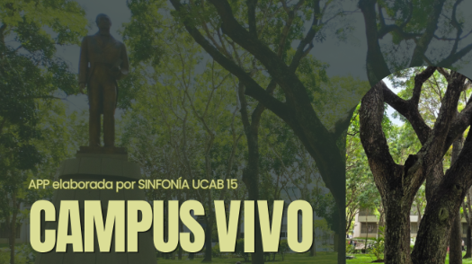

## Resumen de la Propuesta

**Sinfonía UCAB 15: Estación Educativa Itinerante / App CampusVivo** es un proyecto seleccionado en el marco del **1er Concurso EDTEC Lab 2026**. Surge para enfrentar el fenómeno del *"analfabetismo botánico"* o *"ceguera verde"*: la desconexión habitual de la comunidad universitaria con la riqueza vegetal que la rodea en el campus y en el valle de Caracas (especies emblemáticas como el Bucare, el Apamate y la Jacaranda).

Alineado con los Objetivos de Desarrollo Sostenible (ODS 4: Educación de Calidad, ODS 13: Acción por el Clima y ODS 15: Vida de Ecosistemas Terrestres) y con la identidad ucabista de liderazgo ambiental transformador, el proyecto transforma el campus en un aula abierta y museo interactivo de ciencia ciudadana.

---

## Equipo del Proyecto

- **Integrantes del Equipo:** Amanda Isturriaga Torres, Jean Gabriel Moya, Celsa Afonso Dos Santos

---

## El Desafío: Superar la "Ceguera Verde"

A pesar de convivir en un entorno privilegiado en biodiversidad, los estudiantes suelen percibir la flora como un fondo decorativo e inerte. Esta falta de reconocimiento del patrimonio natural reduce la sensibilidad ante la crisis climática y frena el compromiso ciudadano con la sustentabilidad. 

La propuesta busca transformar esa mirada pasiva en una experiencia vivencial de exploración, aprendizaje botánico y apropiación del territorio biocultural.

---

## La Solución: Estación Itinerante y App CampusVivo

El proyecto combina una **Estación Educativa Itinerante** física con la aplicación móvil **CampusVivo**, estructurada en cuatro funcionalidades clave:

1. **Mapa Interactivo del Campus:** Coordenadas de las zonas verdes y rutas botánicas de la UCAB con fichas taxonómicas de cada especie arbórea (nombre científico, características ecológicas y paisajísticas).
2. **Identificación Taxonómica con PlantNet:** Integración mediante fotografías guiadas de hojas, flores y cortezas para el reconocimiento digital instantáneo de especies.
3. **Mapeo Colaborativo de Nuevos Ejemplares:** Herramienta interactiva para que los estudiantes registren nuevos árboles en el mapa como investigadores ciudadanos.
4. **Comunidad y Foro Socioafectivo:** Espacio de diálogo y reflexión donde la comunidad intercambia observaciones en tres dimensiones: ecológica, paisajística y de vínculo socioafectivo con el entorno universitario.

---

## Competencias que Desarrolla

- **Ciudadanía Global y Compromiso Ético-Ambiental:** Conciencia ecológica activa, ciencia ciudadana y liderazgo ambiental responsable.
- **Competencias Digitales y Manejo de Datos:** Uso aplicado de servicios de geolocalización, consumo de APIs botánicas y registro de datos ecológicos.
- **Aprender Haciendo e Indagación de Campo:** Metodología vivencial que vincula teoría biológica con práctica directa en el campus.

---

## Privacidad, Seguridad y Sostenibilidad

- **Privacidad desde el Diseño (*Privacy by Design*):** Cumplimiento estricto del Código de Ética de la UCAB. La geolocalización se procesa de forma exclusivamente local en el dispositivo del usuario, sin rastreo ni almacenamiento de rutas o ubicaciones de los estudiantes.
- **Sostenibilidad y Extensión:** Concebido para integrarse con la Dirección de Sustentabilidad Ambiental de la UCAB, el programa DIDACTRON y cátedras multidisciplinarias, proyectando visitas guiadas tanto para la comunidad universitaria como para escuelas y comunidades aliadas.
